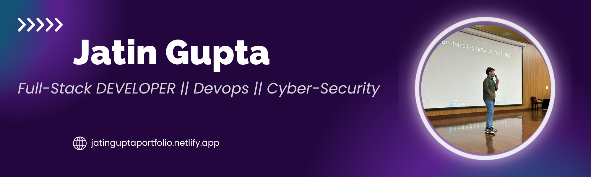

  

<h1>👋 Hello there, I'm Jatin Gupta</h1>

---

<table>
  <tr>
    <td width="60%">

### 💫 About Me

- 🎓 **MCA ’27** at Chhatrapati Shahu Ji Maharaj University (CSJMU), Kanpur  
  (BCA CGPA: **8.20/10** | MCA Sem 2 CGPA: **7.39/10**)
- 👨‍💻 **Full Stack Developer** focused on building scalable web applications with modern architectures
- ☁️ **DevOps & Cloud Enthusiast** — AWS Student Builder Campus Leader | Google Cloud Arcade Legend (310+ Badges)
- 🤖 Hands-on with **Generative AI (RAG, LangChain)**, Distributed Systems & Cloud-Native technologies
- 🏆 Active open-source contributor | **Hacktoberfest Super Contributor** | Organized multiple hackathons
- 🎤 Tech speaker & community lead | Mentored 300+ students through workshops & events

Currently building end-to-end solutions across Full Stack, DevOps, and Cloud while actively contributing to the developer community.  
**Goal:** Become a **Cloud Engineer + Full Stack Engineer** who designs, deploys, and scales intelligent applications.

</td>
    <td width="40%">
      
    </td>
  </tr>
</table>

---

## 🌐 Connect with Me

  
  
  
  
  
  
  
  
  

---

## 💻 Tech Stack

### 🧠 Languages

### ⚛️ Frontend

### 🗄️ Backend & Databases

### 🤖 Generative AI & ML

### ☁️ Cloud & DevOps

---

## 💼 Experience

- **Python Programming Intern** — Infosys Springboard (Jun 2026 – Aug 2026)  
  Built Smart Examination Monitoring Platform using Python, Flask, OpenCV, MediaPipe, YOLO & SQLite with real-time analysis and analytics dashboard.

- **Front End Web Development Intern** — Edunet Foundation (AICTE) (Aug 2025 – Sep 2025)  
  Developed scalable React + TypeScript apps with real-time WebSocket architecture (100+ concurrent users) and CI/CD automation.

- **AI Transformative Learning Intern** — TechSaksham (Microsoft & SAP) (Nov 2024 – Dec 2024)  
  Built Face Recognition Attendance System with ~98% accuracy and reduced manual verification by ~60%.

- **AWS Student Builder Campus Leader** — Amazon Web Services (Sep 2026 – Present)  
  Conducted 10+ cloud sessions and drove AWS Builder Center registrations. Building expertise in AWS services.

- **Secretary** — Code Vidya (Coding Club), CSJMU (2025 – Present)  
  Leading workshops, hackathons, and open-source initiatives for 300+ students.

- **Former Google Gemini Student Ambassador** (2025 – 2026)  
  Conducted AI workshops on LLMs, prompt engineering, and Gemini APIs for 200+ students.

---

## 📂 Featured Projects

### 🤖 **DCA ChatBot** — RAG-Based Generative AI Application
`Python` `LangChain` `ChromaDB` `Node.js` `Next.js`  
Full-stack RAG chatbot with vector database retrieval and LLM-powered responses.

### ⚡ **Quizzer** — Real-Time Quiz Platform
`React` `TypeScript` `FastAPI` `Socket.IO` `PostgreSQL`  
Event-driven platform supporting 300+ concurrent users with live leaderboards and WebSockets.

### 📍 **Geo-Location Attendance System**
`Python` `OpenCV` `Face Recognition` `MySQL`  
Automated attendance with ~98% accuracy using facial recognition + geofencing.

### 💼 **Prep-Mitr** — Placement Preparation Portal
`Next.js` `Node.js` `REST APIs`  
ATS-friendly resume builder + job/internship aggregation platform.

### 🔐 **Live Proctoring / Smart Examination Monitoring System**
`Python` `Flask` `OpenCV` `YOLO` `MediaPipe`  
Real-time face detection and activity monitoring with analytics dashboard.

**[View All Projects →](https://linktr.ee/Jatin_Project)** | **[Open Source Journey →](https://jatinguptaportfolio.netlify.app/open-source)**

---

## 🏆 Highlights & Achievements

### Leadership & Community
- **Organiser** — CSJM × IBM BOB HACKS’26 (AI Hackathon)
- **Event Host & Organizer** — MLH Hacktoberfest Meetup & MLH Hack Day
- **Event Lead** — HackShodh 2026 (200+ participants)
- **NSS Mentor** — Digital Awareness Training (UPES Atal Unit)
- **OSTHON’26 Open Source Challenge Lead** — Kanpur AI

### Hackathons
- Ranked **13th** — Hack AI DevFest 2024
- **2nd Runner-up** — Geek-Week Hackathon 2023
- Hacktoberfest **Super Contributor** (20+ merged PRs across multiple years)

### Certifications & Cloud
- **Google Cloud Arcade 2× Legend** | **310+ GCP Badges** (Compute, Storage, Networking, Containers & more)
- Microsoft Certified: **Fabric Data Engineer Associate**
- **Oracle AI Vector Search** Certified Professional
- **Redis** Associate Cloud Operator
- IBM SkillBuild AI Fundamentals
- AWS SBCL 6-Week Programme Completion
- Google Cloud Arcade Season achievements (Primary, Secondary & New accounts)

---

## 📫 Let's Connect!

- **Portfolio:** [jatinguptaportfolio.netlify.app](https://jatinguptaportfolio.netlify.app)
- **Professional Journey:** [jatin-professional-journey.netlify.app](https://jatin-professional-journey.netlify.app/)
- **Cloud Profile (Arcade):** [jatingcpprofile.netlify.app](https://jatingcpprofile.netlify.app/)
- **LinkedIn:** [linkedin.com/in/jatingupta09](https://www.linkedin.com/in/jatingupta09/)
- **Email:** official.jatingupta09@gmail.com
- **GitHub:** [github.com/jatin009v](https://github.com/jatin009v)
- **Twitter:** [twitter.com/guptaji7932](https://twitter.com/guptaji7932)
- **Dev.to:** [dev.to/jatin09](https://dev.to/jatin09)
- **LeetCode:** [leetcode.com/u/jatin_009v](https://leetcode.com/u/jatin_009v/)

*Open to collaborations on Full-Stack Development, Generative AI (RAG), DevOps, Cloud-Native architectures, and Open Source.*

**Building the path towards Cloud Engineer + Full Stack Engineer** 🚀
